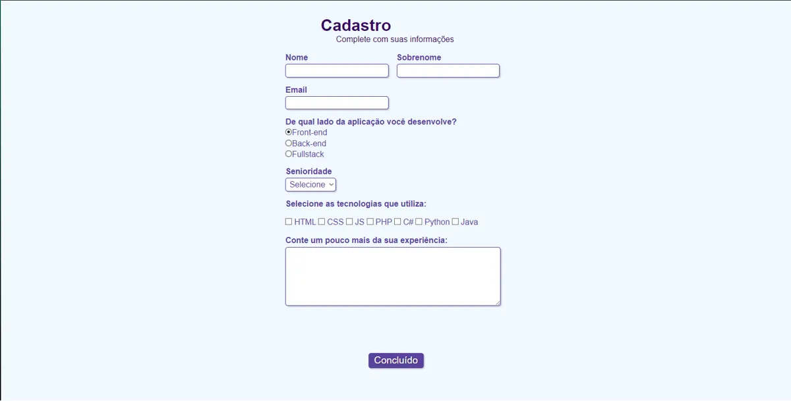

# Formulário de Cadastro

Formulário de cadastro para **desenvolvedores**, com vários tipos de campo de formulário em HTML.

🔗 **[Ver o site no ar](https://iamviniciuslima05.github.io/PROJETO-Formulario/html/formulario.html)**



## O que tem no projeto

- Campos de texto para nome, sobrenome e e-mail
- **Botões de opção** para a área de atuação
- **Seleção de senioridade**
- **Caixas de marcação** para as tecnologias
- Área de texto para contar a experiência

## Tecnologias

HTML5 · CSS3

## Estrutura

```
html/ → página (formulario.html)
css/  → estilos (formulario.css)
```

## Como rodar

Abra `html/formulario.html` no navegador ou acesse a versão publicada acima.

---
Feito por **Vinicius Lima** · [Portfólio](https://viniciuslimadev.netlify.app) · [LinkedIn](https://www.linkedin.com/in/viniciuslima25/)
